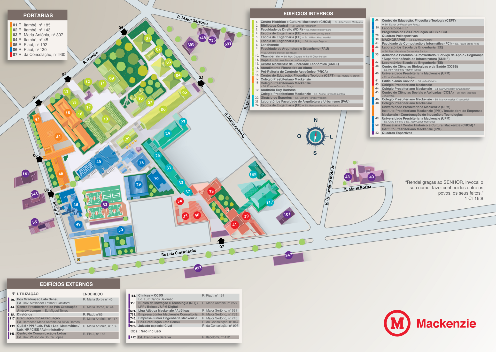

# Mackenzie Urban Digital Twins

Projeto de implementação de ontologia para gêmeos digitais urbanos.

## Autores

- Daniel Yoshio Omiya
- Gabriel Mason Guerino
- Pedro Bacic Branco

**Orientação:** Prof. Dr. Fabio Silva Lopes

---

